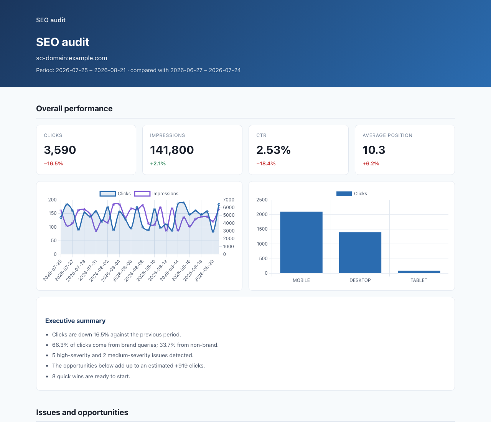

<!-- mcp-name: io.github.acamolese/google-search-console-mcp -->

# Google Search Console MCP

**English** · [Italiano](README.it.md)

[](https://github.com/acamolese/google-search-console-mcp/actions/workflows/ci.yml)
[](https://pypi.org/project/mcp-google-search-console/)
[](https://pypi.org/project/mcp-google-search-console/)
[](LICENSE)

Seventeen read-only tools over the Google Search Console API, plus a deterministic
white-label HTML audit report an agency can put its own name on and send to a
client, in English or Italian.



Regenerate that report from committed synthetic data, with no credentials:

```bash
python scripts/render_sample_report.py --lang en --open
```

## Install

### Claude Code

```bash
/plugin marketplace add acamolese/google-search-console-mcp
/plugin install google-search-console@acamolese
```

The plugin brings the MCP server, five skills (weekly review, cannibalisation
check, indexing audit, content opportunities, white-label client audit) and a
config prompt for the three credentials.

### Claude Desktop

Download `google-search-console.mcpb` from the
[latest release](https://github.com/acamolese/google-search-console-mcp/releases)
and open it. It needs [uv](https://docs.astral.sh/uv/) installed. Or edit the
config file directly:

```json
{
  "mcpServers": {
    "google-search-console": {
      "command": "uvx",
      "args": ["mcp-google-search-console"],
      "env": {
        "GSC_CLIENT_ID": "...",
        "GSC_CLIENT_SECRET": "...",
        "GSC_REFRESH_TOKEN": "..."
      }
    }
  }
}
```

### Cursor, Codex, Gemini CLI, Zed

Any MCP client takes the same three lines: command `uvx`, argument
`mcp-google-search-console`, and the three `GSC_*` environment variables.

```bash
# Codex
codex mcp add google-search-console -- uvx mcp-google-search-console

# Gemini CLI
gemini mcp add google-search-console uvx mcp-google-search-console
```

### Docker

```bash
docker build -t mcp-gsc .
docker run --rm -p 127.0.0.1:8765:8765 \
  -e GSC_CLIENT_ID -e GSC_CLIENT_SECRET -e GSC_REFRESH_TOKEN \
  -v "$PWD/reports:/reports" mcp-gsc
```

The container speaks streamable HTTP on `/mcp`. It has no authentication of its
own: keep it on loopback or behind a reverse proxy.

## Authentication

The OAuth scope is `webmasters.readonly` and nothing else. No tool in this server
can modify a property, a sitemap or anything else in Search Console.

Credentials are resolved in this order:

1. `GSC_AUTH_MODE` if set (`oauth`, `service_account`, `adc`)
2. `GSC_SERVICE_ACCOUNT_FILE` or `GSC_SERVICE_ACCOUNT_JSON`
3. `GSC_CLIENT_ID` + `GSC_CLIENT_SECRET` + `GSC_REFRESH_TOKEN`
4. A token file in `~/.config/mcp-google-search-console/`
5. Application Default Credentials

### OAuth, once

1. In [Google Cloud Console](https://console.cloud.google.com/), enable the
   **Google Search Console API** and create an OAuth client of type
   **Desktop app**.
2. Export the client, or save the downloaded JSON as
   `~/.config/mcp-google-search-console/oauth_credentials.json`:

   ```bash
   export GSC_CLIENT_ID="...apps.googleusercontent.com"
   export GSC_CLIENT_SECRET="..."
   uvx mcp-google-search-console auth
   ```

3. The browser flow prints the three `export` lines for a stateless setup, and
   also stores a token at `~/.config/mcp-google-search-console/token.json` with
   `0600` permissions.

On a headless machine, run `auth` on your laptop and copy the three environment
variables across. `--no-browser` prints the URL instead of opening one, but still
needs a local redirect.

### Service account

Grant the service account's email read access to the property in Search Console,
then point the server at the key:

```bash
export GSC_SERVICE_ACCOUNT_FILE=/path/to/key.json
# or, for a container:
export GSC_SERVICE_ACCOUNT_JSON='{"type":"service_account",...}'
```

### Check it works

```bash
uvx mcp-google-search-console doctor
```

Prints the auth mode in use, when the token expires, how many properties the
account can read, and the defaults every tool applies. Secrets are masked. Exits
1 when nothing resolves, which is the answer to most "the server won't start"
reports.

## Tools

| Tool | What it answers |
|---|---|
| `gsc_sites` | Which properties can this account read, and in what exact format |
| `gsc_site_details` | Permission level and type for one property |
| `gsc_query` | The Search Analytics report, with filters, dimensions and pagination |
| `gsc_performance_overview` | Is the site up or down, against the previous period |
| `gsc_compare_periods` | What changed between two periods, ranked by click delta |
| `gsc_quick_wins` | Queries close enough to the top that a push would pay off |
| `gsc_ctr_gaps` | Pages that rank but are not clicked |
| `gsc_cannibalization` | Queries where several pages compete against each other |
| `gsc_traffic_drops` | Pages that lost clicks, with a likely cause for each |
| `gsc_content_decay` | Pages sliding down month after month |
| `gsc_alerts` | What moved sharply enough to be worth a message today |
| `gsc_portfolio` | Every property at a glance, worst first |
| `gsc_indexing_issues` | Which of these URLs are indexed, and why not |
| `gsc_inspect_url` | Full URL Inspection for one page |
| `gsc_sitemaps` | Which sitemaps Google knows about, with errors and warnings |
| `gsc_doctor` | What is configured, and does the API answer |
| `gsc_audit` | The full HTML report |

Three prompts wrap the workflows that repeat: `gsc_weekly_report`,
`gsc_indexing_audit`, `gsc_content_opportunities`.

## Why this server

| | Here | Typical GSC MCP server |
|---|---|---|
| Client-ready report | Self-contained HTML, English or Italian, white-label | none |
| Analysis | Cannibalisation, CTR gaps, decay, drop diagnosis, run server-side | raw rows, analysed by the model |
| Thresholds | Adapt to the size of the property | fixed, or none |
| Dates | `period="last_month"`, `days=28`, resolved server-side | explicit dates only |
| Freshness | `dataState=all` by default, matching the UI | `final` only |
| Auth | OAuth, service account, ADC | OAuth only |
| Output | TSV by default, roughly a third of the tokens of pretty JSON | `json.dumps(indent=2)` |
| Errors | Google's reason plus what to do about it | bare HTTP status |
| Tests | 280+, on both `mcp` majors, three operating systems | usually none |

## Report customisation

Colours, logo, report name, brand terms and thresholds come from a JSON file.
Pass `branding_path`, or place it at
`~/.config/mcp-google-search-console/branding.json` to apply it everywhere:

```json
{
  "brand_name": "Your Agency",
  "logo": "logo.png",
  "brand_terms": ["clientbrand", "client brand"],
  "colors": { "primary": "#2b6cb0", "primary_dark": "#1a365d" },
  "thresholds": { "min_impressions": 200 }
}
```

A local logo is base64-encoded into the document. A remote one is only kept if
`allow_external_fonts` is true, because the report is otherwise guaranteed to
contain no external URL at all: no CDN, no font service, nothing that phones home
when a client opens it.

`brand_terms` matters more than it looks. Without it, the first label of the
domain is used as the brand, which is wrong for abbreviations, holding companies
and invented names, and it silently mislabels the brand/non-brand split. The
report says when it had to guess.

## Quotas and limits

- **16 months** of daily data. Anything older is not available at any price.
- **Hourly data**: the last 10 days only.
- **URL Inspection**: 600 per minute and **2,000 per day per property**. This is
  the limit that bites on a large site.
- **Search Analytics**: 1,200 queries per minute per site. Responses are cached
  in memory for 6 hours (1 hour for inspections); `no_cache=true` bypasses it.
- **Rows**: 25,000 per API call. Tools default to 100 and cap at 1,000, with
  `start_row` for pagination; the cap is reported in the response, never applied
  silently.

## Environment variables

| Variable | Default | Purpose |
|---|---|---|
| `GSC_CLIENT_ID`, `GSC_CLIENT_SECRET`, `GSC_REFRESH_TOKEN` | | Stateless OAuth |
| `GSC_SERVICE_ACCOUNT_FILE`, `GSC_SERVICE_ACCOUNT_JSON` | | Service account |
| `GSC_AUTH_MODE` | auto | Force `oauth`, `service_account` or `adc` |
| `GSC_REPORT_LANGUAGE` | `en` | Report language: `en` or `it` |
| `GSC_DATA_STATE` | `all` | `all` includes today's partial data, `final` does not |
| `GSC_CACHE_TTL_SECONDS` | `21600` | Response cache TTL; `0` disables it |
| `GSC_INSPECT_CONCURRENCY` | `5` | Parallel URL inspections |
| `GSC_LOG_LEVEL` | `WARNING` | Logging, always to stderr |
| `MCP_TRANSPORT`, `MCP_HOST`, `MCP_PORT` | `stdio` | Transport |

## Troubleshooting

**`spawn uvx ENOENT`** — the client cannot find `uvx` on its PATH. GUI apps do
not inherit a shell PATH. Use the absolute path: `which uvx` gives it, typically
`/Users/you/.local/bin/uvx`.

**`403 forbidden` on every call** — almost always the property format. A domain
property is `sc-domain:example.com`; a URL-prefix property is
`https://example.com/`, trailing slash included. `gsc_sites` returns the exact
strings.

**`401 invalid_grant`** — the refresh token was revoked or expired. Google expires
refresh tokens for OAuth apps still in "testing" after seven days; publish the
app, or re-run `auth`.

**`403 quotaExceeded`** — the daily URL Inspection quota is gone. It resets
tomorrow; nothing retries past it.

**Empty report on a small site** — check the thresholds in the response meta. They
adapt to the property, but the floors (50 impressions, 10 clicks) still apply.
Pass `thresholds` to lower them.

**Anything else** — run `doctor` and include its output in the issue.

## Security

- Read-only scope, requested and never widened.
- Token files are written atomically with `0600` permissions. Credentials supplied
  through the environment are never written to disk.
- `gsc_doctor` masks the client ID and never returns a token.
- No telemetry, no analytics, no request to any host other than Google's API.

See [SECURITY.md](SECURITY.md) for the reporting policy.

## Development

```bash
uv venv && uv pip install -e ".[dev]"
ruff check src tests scripts && ruff format --check src tests scripts
pytest -q --cov=google_search_console_mcp
python scripts/sync_versions.py
python scripts/render_sample_report.py --lang it --open
```

Tests never hit the network. Live tests exist behind `-m live` and require
`GSC_LIVE_TESTS=1` plus credentials; they never run in CI.

Releases: see [docs/RELEASING.md](docs/RELEASING.md). Decisions not covered by the
code are logged in [docs/DECISIONS.md](docs/DECISIONS.md).

## License

MIT. Chart.js 4.5.1 is vendored under `src/google_search_console_mcp/static/`,
also MIT, with its licence alongside.
